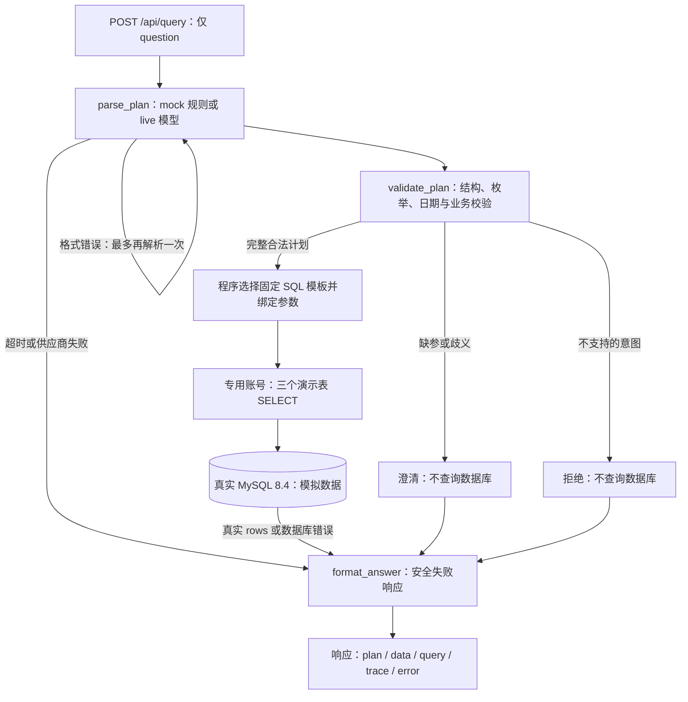

# 电商经营分析工作流助手

一个**受限工具型电商经营查询 Agent**：将问题转换为结构化查询计划，由程序校验并选择固定 SQL 模板，以专用只读账号查询 MySQL，再展示结果、计划、SQL 模板及节点执行过程。

**所有业务数据均为模拟数据。** 项目支持三个固定查询类型，不提供任意 SQL、任意筛选、预测、退款、利润、明细导出、原因推断或数据库写操作。实际验收记录见 [docs/verification.md](docs/verification.md)，固定用例评测报告见 [docs/evaluation.mock.json](docs/evaluation.mock.json)。真实模型与 mock 的验收分别记录，不能相互替代。

## 能查询什么

| 查询类型 | 结果与排序 | 可复制的 mock 演示表达 |
| --- | --- | --- |
| `daily_sales` | 每日销售额、销量；日期升序；无记录日期不补零 | 查询从2026-10-01（含）到2026-10-04（不含）的每日销售额和销量 |
| `category_sales` | 品类销售额、销量；金额降序，再按品类升序 | 查询从2026-10-01（含）到2026-10-04（不含）的品类销售额和销量 |
| `top_products` | 商品销售额、销量；指定指标降序，分数相同按商品 ID 升序 | 按销售额查询从2026-10-01（含）到2026-10-04（不含）的前2个商品 |

商品排行可将“按销售额”改为“按销量”，问题中必须明确写出 1—10 的阿拉伯数字 `N`，如“前2个商品”；中文数词如“前两个”暂未实现，不能由模型猜测数量。计划固定为 `query_type`、`start_date`、`end_date`、`rank_by`、`top_n` 五个字段；每日和品类查询的后两个字段为 `null`。日期跨度最多 90 个自然日。

缺日期、结束日期是否包含不明确、商品排行缺指标或数量时会澄清，不猜测。“卖得最好”不能替代销售额或销量口径。明确包含结束日期时会转换为次日的排他上界，并在响应中展示。相对日期暂不支持；请提供两个完整的 `YYYY-MM-DD` 日期。每次请求独立，**没有跨请求记忆**；收到澄清后，应把原问题和补充条件一起重新提交。

当前只接受整日日期区间，不接受具体时分秒或带时间的区间。带时间、冲突的查询类型或互相矛盾的日期边界需要重新澄清；不会忽略这些条件后执行另一个查询。

## 数据与统计口径

只统计 `orders.status='paid'` 的订单，以支付时间筛选：`paid_at >= start AND paid_at < end`。销售额为下单成交单价 `order_items.unit_price × quantity` 的总和，销量为商品件数总和；未支付及已取消订单均排除。

- 金额在 MySQL 中用 `DECIMAL` 计算，在 Python 中保持 `Decimal`，响应为两位小数字符串，如 `"340.00"`，销量为整数；统一人民币。
- `paid_at` 是 `DATETIME(6)`，约定存储 `Asia/Shanghai` 当地时间。应用以当地零点生成参数，连接会话设为 `+08:00`。`DATETIME` 本身不携带时区，数据库不会替应用自动转换时区。
- 空区间返回成功、`data=[]` 和“该区间没有符合口径的记录”，不补造日期或金额。

固定模拟数据使用稳定主键：P1 键盘/数码、P2 鼠标/数码、P3 杯子/家居，成交单价分别为 100.00、50.00、30.00。

| 订单 | 状态与支付时间（当地时间） | 明细 |
| --- | --- | --- |
| O1001 | paid，2026-10-01 00:00:00 | P1×2、P2×1 |
| O1002 | paid，2026-10-01 23:59:59.999999 | P3×3 |
| O1003 | paid，2026-10-02 00:00:00 | P1×1、P3×2 |
| O1004 | paid，2026-10-04 00:00:00 | P2×4 |
| O1005 | paid，2026-09-30 23:59:59.999999 | P1×1 |
| O1006 | unpaid，NULL | P1×10 |
| O1007 | cancelled，2026-10-02 12:00:00 | P2×10 |

按固定记录人工计算，区间 `[2026-10-01, 2026-10-04)` 应合计 **500.00**：每日 340.00、160.00；数码 350.00、家居 150.00；商品金额 P1 300.00、P3 150.00、P2 50.00；商品销量 P3 5、P1 3、P2 1。2026-10-03 无记录。应用必须查询 MySQL 得到这些结果，代码不预置查询答案。实际数据库核对证据见验收记录。

## 架构与安全边界



LangGraph 使用请求级 `TypedDict`、`StateGraph` 和条件边，主链路为 `parse_plan → validate_plan → execute_query → format_answer`。未使用 checkpointer、持久化记忆或多 Agent。同步 FastAPI 路由在线程池内运行图和 PyMySQL，不阻塞事件循环。

- 模型只产计划；不接收数据库密码、管理员配置或全表数据。严格 DTO 禁止额外字段及字符串形式的整数。客户端不能提交 state、SQL、角色或重试次数。
- SQL 的表名、字段、关联和排序由程序固定；排行仅有两个固定分支。日期、N 和结果限额全部通过 PyMySQL `%s` 绑定。Prompt 不是权限边界。
- 运行账号只获 `products`、`orders`、`order_items` 三张表的 SELECT。连接检查实际身份、角色与完整授权；发现额外权限即拒绝。只读事务作为附加限制。
- 默认服务端 `max_execution_time=2000` 毫秒；客户端连接、读写及连接名额等待也有有限超时。客户端 read timeout 只表示停止等待，不能证明服务器查询被中止。
- 默认每个进程最多 4 个数据库连接，使用单 Uvicorn worker。每日最多 90 行，商品排行最多 10 行；品类读取最多 101 行，超过 100 行会澄清并要求缩小范围，不静默截断。LIMIT 不能替代服务器执行时间限制。
- trace 只记录节点名、结果和耗时，格式重试可见；响应和日志不包含数据库连接信息、Authorization、原始模型响应或异常堆栈。

## 环境与目录

使用 Python **3.11**、FastAPI、Pydantic v2、LangGraph、httpx、MySQL **8.4**、PyMySQL、pytest。没有 ORM 或 SQLite。实际安装并验证的依赖版本固定在 [requirements.txt](requirements.txt)，实际 Python/MySQL 版本记录在验收文档。Compose 的 MySQL 镜像和 Dockerfile 的 Python 基础镜像均固定到本次使用的 digest。

```text
app/        # 运行时配置、DTO、模型、工作流、固定查询、只读仓库及回答格式
scripts/    # 本地配置生成、管理员初始化/seed、mock/live 评测
tests/      # 单元测试与显式启用的真实 MySQL 集成测试
evals/      # 14 条人工编写的语义用例与标准计划/rows
sql/        # InnoDB、utf8mb4 结构、约束、外键与索引
docs/       # 真实演示响应、面试说明、验收记录及安全评测报告
```

运行时只读取 `.env` 和明确允许的环境变量，环境变量优先。管理员配置单独存于 `.env.admin`，仅管理员初始化和 seed 路径使用；应用查询失败时不会改用管理员账号。两个文件、虚拟环境、缓存、本地数据库文件及原始日志均忽略提交。

### 运行时变量：`.env`

| 变量 | 默认/示例 | 约束与含义 |
| --- | --- | --- |
| `APP_ENV` | `development` | development / test / production；不是生产部署安全开关 |
| `APP_TIMEZONE` | `Asia/Shanghai` | 当前固定为此业务时区 |
| `MODEL_MODE` | `mock` | mock / live；每条响应显示实际模式 |
| `MODEL_BASE_URL` | `https://your-provider.example/v1` | live 必填版本根路径；程序追加 `/chat/completions`；远端必须 HTTPS，不含凭据、query 或 fragment |
| `MODEL_NAME` | 空 | live 必填供应商实际模型名 |
| `MODEL_API_KEY` | 空 | live 必填；只存本地或受控环境变量，不提交 |
| `MODEL_JSON_MODE` | `json_object` | 按供应商能力选择 json_object / json_schema，仍执行本地 schema 校验 |
| `MODEL_TOTAL_TIMEOUT` | `15` 秒 | 0.1—60；最多两次格式尝试共用的总等待预算 |
| `MODEL_CONNECT_TIMEOUT` | `3` 秒 | 0.1—30 |
| `MODEL_READ_TIMEOUT` | `10` 秒 | 0.1—60 |
| `MODEL_WRITE_TIMEOUT` | `3` 秒 | 0.1—30 |
| `MODEL_POOL_TIMEOUT` | `2` 秒 | 0.1—30 |
| `DB_HOST` / `DB_PORT` | `127.0.0.1` / `3307` | 本机连接；端口 1—65535。Compose API 自动覆盖为 db / 3306 |
| `DB_NAME` | `order_query_demo` | 仅允许此库或显式测试库 order_query_demo_test |
| `DB_USER` | `order_query_reader` | 专用只读账号；拒绝明显管理员账号名 |
| `DB_PASSWORD` | 本地随机生成 | 必填，必须与管理员密码不同 |
| `DB_CONNECT_TIMEOUT` | `3` 秒 | 1—30 |
| `DB_READ_TIMEOUT` | `5` 秒 | 1—60，必须大于服务器执行时间限制 |
| `DB_WRITE_TIMEOUT` | `3` 秒 | 1—30；是 socket 写超时，不赋予数据库写权限 |
| `DB_MAX_EXECUTION_TIME` | `2000` 毫秒 | 1—5000，设置 MySQL 会话执行限制 |
| `DB_MAX_CONCURRENCY` | `4` | 1—4；每进程并发连接上限 |
| `DB_ACQUIRE_TIMEOUT` | `2` 秒 | 0.1—10；等待连接名额的上限 |

### 管理员变量：`.env.admin`

| 变量 | 演示默认 | 用途 |
| --- | --- | --- |
| `DB_ADMIN_HOST` / `DB_ADMIN_PORT` | `127.0.0.1` / `3307` | init/seed 的明确管理连接；bootstrap 覆盖为 db / 3306 |
| `DB_ADMIN_USER` | `root` | 演示库初始化账号，不注入长期运行的 API |
| `DB_ADMIN_PASSWORD` | 另一份本地随机密码 | Compose 仅将此值插值到 db 的 MYSQL_ROOT_PASSWORD；bootstrap 接收管理员文件完成一次性初始化 |
| `DB_ADMIN_ALLOWED_HOSTS` | `127.0.0.1,localhost,db` | 管理连接目标白名单，禁止自动猜测其他数据库 |
| `MYSQL_ROOT_HOST` | `%` | 仅演示 Docker 初始化使用，原因及边界见下文 |

初始化只允许两个显式演示库名。已存在的未知表、结构、索引、触发器、账号授权或 seed 记录冲突会报错并保留现场；不迁移、不清空、不覆盖。init 可安全补齐兼容的缺失对象，seed 在事务内核对全部固定记录后只插入缺项。没有默认 reset、DROP 或 TRUNCATE 入口。

## 本机 API + Docker 数据库：推荐复现路径

在项目根目录打开 PowerShell，确认 `python --version` 为 3.11，Docker Desktop 的 Linux 引擎已运行，3307 和 8002 端口可用。

```powershell
python -m venv .venv
.\.venv\Scripts\Activate.ps1
python -m pip install -r requirements.txt
python -m scripts.setup_local
docker compose --env-file .env.admin up -d db --wait
python -m scripts.init_db
python -m scripts.seed_db
python -m scripts.evaluate --mode mock --output docs/evaluation.mock.json
$env:RUN_MYSQL_TESTS = "1"
python -m pytest
python -m uvicorn app.main:app --host 127.0.0.1 --port 8002
```

`scripts.setup_local` 根据示例文件生成两份不同的随机密码，只写本地文件，不打印秘密，也不覆盖已存在的 `.env` 或 `.env.admin`。已有配置应自行核对与当前数据库一致；修改密码不会修改已有 MySQL 卷中的账号密码。若 PowerShell 阻止虚拟环境激活，可将上述后续 `python` 替换为 `.\.venv\Scripts\python.exe`，无需更改系统执行策略。Linux/macOS 使用 `source .venv/bin/activate`。

`--wait` 等待 db 健康检查就绪后再进行初始化，避免容器刚启动时的连接竞态。如果等待失败，先用 `docker compose --env-file .env.admin ps` 确认状态。管理员脚本均需明确成功，随后才进行评测。再次运行以下两个入口应核对现有状态，不产生重复记录：

```powershell
python -m scripts.init_db
python -m scripts.seed_db
```

服务默认仅监听回环地址。[交互接口文档](http://127.0.0.1:8002/docs) 可用于发送请求；另开一个 PowerShell 验证健康及查询：

```powershell
Invoke-RestMethod http://127.0.0.1:8002/health
$body = @{ question = '按销售额查询从2026-10-01（含）到2026-10-04（不含）的前2个商品' } | ConvertTo-Json
Invoke-RestMethod -Method Post -Uri http://127.0.0.1:8002/api/query -ContentType 'application/json; charset=utf-8' -Body ([Text.Encoding]::UTF8.GetBytes($body)) | ConvertTo-Json -Depth 20
```

更多实际请求和完整响应见 [docs/demo.md](docs/demo.md)。

## 全服务 Docker Compose 复现

先完成 Python 环境、依赖安装和 `python -m scripts.setup_local`，然后：

```powershell
docker compose --env-file .env.admin up --build -d
docker compose --env-file .env.admin ps
Invoke-RestMethod http://127.0.0.1:8002/health
```

顺序为 `db 健康 → bootstrap 成功退出 → api`。bootstrap 容器运行 `python -m scripts.init_db` 和 `python -m scripts.seed_db`，使用相同幂等入口。API 镜像仅包含运行时代码，仅接收 `.env`；管理员文件只用于 db 初始化及一次性 bootstrap。

- 数据库宿主映射为 `127.0.0.1:3307:3306`，API 为 `127.0.0.1:8002:8002`。容器中的 Uvicorn 使用 `--host 0.0.0.0 --port 8002`，以便回环地址的端口映射可达。
- db 和 bootstrap 位于本项目的普通 bridge 网络，API 另有模型出站网络。演示中 `MYSQL_ROOT_HOST=%` 让宿主 init 和 bootstrap 均能连接管理账号；宿主数据库端口始终只绑定回环地址。这是本地开发方案，不应据此宣称适用于生产部署。
- `demo_mysql_data` 命名卷保留数据。停止时可运行 `docker compose --env-file .env.admin stop`；不要运行 `down -v` 或删除已有数据库卷。已有卷的初始化密码与环境文件不一致时应先查明配置，不破坏性重建。
- 本机 API 与容器 API 不应同时占用 8002。执行全容器复现前，先停止本机 Uvicorn。

## 已有本机 MySQL 8.4

不使用 Docker 时，提供一个明确可访问的 MySQL 8.4 实例和已知管理员凭据；不要连接生产库，也不要搜寻本机已有凭据。保留两个演示库白名单，按实际环境修改：

| 文件 | 需要核对的变量 |
| --- | --- |
| `.env` | DB_HOST、DB_PORT（本机常为3306）、DB_NAME、DB_USER、DB_PASSWORD |
| `.env.admin` | DB_ADMIN_HOST、DB_ADMIN_PORT、DB_ADMIN_USER、DB_ADMIN_PASSWORD、DB_ADMIN_ALLOWED_HOSTS |

运行账号和管理员必须不同，密码也必须不同。`MYSQL_ROOT_HOST` 只用于 Docker 初始化，对已有本机账号不起作用。之后沿用相同入口：

```powershell
python -m scripts.init_db
python -m scripts.seed_db
python -m scripts.evaluate --mode mock
$env:RUN_MYSQL_TESTS = "1"
python -m pytest
python -m uvicorn app.main:app --host 127.0.0.1 --port 8002
```

Docker 不可用且没有可用的 MySQL 8.4 时，可以运行单元测试，但数据库验收必须标记为未完成。SQLite 不能替代本项目的数据库验收。

## mock 与 live

`MODEL_MODE=mock` 只替代计划解析。规则代码可审查，仅支持上述演示表达和 [evals/cases.json](evals/cases.json) 覆盖的小范围语法：每日/品类/商品排行、两个绝对日期、明确结束边界，以及排行指标和阿拉伯数字 N。不解释中文数词、相对日期或时分秒。无法识别时会澄清或拒绝。所有后续查询仍然访问真实 MySQL，因此 mock 结果能验证工作流、SQL、权限和接口，不能证明真实模型的中文理解能力。

live 使用兼容 Chat Completions 的供应商服务。在 `.env` 中设置 `MODEL_BASE_URL`、`MODEL_NAME`、`MODEL_API_KEY`，并根据供应商支持设置 `MODEL_JSON_MODE`。启动 live API 时还须设置 `MODEL_MODE=live`；仅进行评测时，`--mode live` 会明确覆盖文件中的模式：

```powershell
python -m scripts.evaluate --mode live
```

需要实际密钥及明确的模型调用授权后再运行。缺配置会非零退出，不回退到 mock。当前交付的真实模型验收状态以验收记录为准，未配置或未执行不得记为通过。模型格式错误最多重试一次；鉴权、限流、网络异常和超时分别记录，不伪装成“不支持的问题”。不进行数据库重试或账号切换。

## API 合同

`GET /health` 检查运行时配置和只读 MySQL 连接；健康时返回 200，并包含 `model_mode`、`database="mysql"`、`database_ready=true` 和服务器版本。数据库不可用返回 503。健康检查不调用付费模型，**mock 健康和 live 配置通过均不代表真实模型调用已验收**。

`POST /api/query` 仅接受：

```json
{"question":"按销售额查询从2026-10-01（含）到2026-10-04（不含）的前2个商品"}
```

`question` 必须是字符串，去除首尾空白后长度为 1—1000；额外字段、客户端 state、SQL、model_mode 和数据库参数均禁止。未启用宽泛 CORS。

| 统一响应字段 | 含义 |
| --- | --- |
| `request_id` | 服务端生成；同一次请求的响应、trace 和日志使用同一标识 |
| `status` | success / needs_clarification / unsupported / failed |
| `model_mode` | 实际 mock / live 模式 |
| `answer` | 依据当前真实状态确定性生成的说明，含统计口径及区间 |
| `plan` | 完整且经程序校验的计划，未得到合法计划时为 null |
| `data` | 实际 rows；金额为两位字符串、销量为整数，未成功查询时为空数组 |
| `query` | 已尝试业务查询的 template_id、含占位符的 sql_template 和安全 params；未尝试业务查询时为 null |
| `trace` | 节点、执行结果、耗时及解析尝试次数，无原始敏感信息 |
| `error` | null，或稳定 code、安全 message 及可选 category |

`data` 的行字段：每日为 `payment_date / sales_amount / sales_quantity`；品类为 `category / sales_amount / sales_quantity`；商品为 `product_id / sku / product_name / category / sales_amount / sales_quantity`。完整实跑 JSON 响应见演示文档，评测报告另保存每条用例的实际计划和 rows。

| 情况 | HTTP | status / error code |
| --- | --- | --- |
| 正常完成，包括空数据 | 200 | success / error=null |
| 缺参、歧义、日期或 N 需要调整 | 200 | needs_clarification |
| 品类结果超过100行 | 200 | needs_clarification / RESULT_LIMIT_EXCEEDED |
| 超出范围或写操作 | 200 | unsupported |
| 请求字段、类型、长度或 JSON 非法 | 422 | 保留 FastAPI/Pydantic 默认校验格式，**不使用统一业务响应格式** |
| 两次模型输出仍非法 | 502 | failed / MODEL_OUTPUT_INVALID |
| 模型供应商网络、鉴权或限流异常 | 502 | failed / MODEL_PROVIDER_ERROR；category 区分原因 |
| 模型等待超时 | 504 | failed / MODEL_TIMEOUT |
| 数据库不可达、授权不符合或连接名额等待超时 | 503 | failed / DB_UNAVAILABLE |
| MySQL 服务器查询超时 | 504 | failed / QUERY_TIMEOUT |
| 固定查询异常或内部错误 | 500 | failed / QUERY_FAILED 或 INTERNAL_ERROR |

## 测试与语义评测

```powershell
# 单元测试；未启用的真实 MySQL 项会明确跳过
python -m pytest

# 数据库初始化成功后，显式开启真实 MySQL 集成测试
$env:RUN_MYSQL_TESTS = "1"
python -m pytest

# mock 计划解析 + 真实 MySQL；默认报告写 stdout
python -m scripts.evaluate --mode mock
python -m scripts.evaluate --mode mock --output docs/evaluation.mock.json

# 真实模型 + 真实 MySQL；需要模型配置和调用授权
python -m scripts.evaluate --mode live
```

14 条语义用例中，**8 条检验真实查询结果、3 条检验澄清、3 条检验拒绝**。包含每日、品类、两种商品排名、上下时间边界、空区间、500.00 累计金额、缺排名口径、缺日期、结束边界不清、预测拒绝、删除拒绝和 SQL 指令拒绝。

标准计划和 rows 人工编写，独立 SQL 核对与执行证据见验收记录；不从被测模板反向生成期望值。比较精确 Decimal、整数类型、行顺序和重复行；空结果必须同时匹配计划及日期区间。澄清和拒绝检查业务查询调用次数为零，不纳入 SQL 结果正确数。格式化回答检查已支付口径、模拟数据标识、日期和金额一致性。

报告分别给出模式、Python/MySQL 版本、总用例数、计划/状态通过数、查询结果正确数、非查询通过数、回答校验、错误分类和耗时。失败返回非零退出状态；配置或数据库预检失败时标明未运行数量，不能算通过。这里只衡量固定用例，不将其泛化成“通用查询准确率”。

技术测试覆盖严格 DTO、日期与排名限制、客户端注入、有限格式重试、供应商错误、数据库错误、连接关闭、并发限制和安全错误信息。真实 MySQL 检查先核对授权，再执行不匹配任何记录的写权限拒绝探测，并比较前后 seed 数据；服务器超时以 MySQL 错误 3024 为证据，客户端 socket timeout 不算通过。未经启用的集成测试不能替代真实数据库验收。

## 实际结果与限制

2026-10-15 使用宿主 Python **3.11.16**、真实 MySQL **8.4.11** 完成 mock 语义评测：计划/状态 **14/14**、查询结果 **8/8**、澄清与拒绝 **6/6**、回答校验 **14/14**，退出状态为0。6条非查询用例的业务查询次数均为0。这些结果仅针对本仓库固定模拟数据及用例。

已显式启用并运行5项真实 MySQL 集成检查，覆盖模板结果、边界与口径、授权/无数据影响的写权限拒绝，以及服务器执行超时；完整测试的最终数量和复现证据见验收记录。真实模型未配置，**live 尚未验收**，不能将 mock 结果当作真实模型结果。

- [验收记录](docs/verification.md)：版本、实际命令、退出状态、测试计数、权限与超时证据、Docker/本机复现状态及未验证项。
- [mock 语义评测报告](docs/evaluation.mock.json)：每条标准用例的实际计划、rows、状态与耗时；仅在真实运行后生成。
- [演示请求和实跑响应](docs/demo.md)：商品金额排行、每日销售、口径澄清及写操作拒绝。
- [面试说明](docs/interview.md)：设计取舍、能力边界和可据实采用的简历措辞。

项目面向本地演示，未加入用户认证、生产部署、性能基准或真实业务数据接入。没有任意 schema 检索、向量库、推荐、预测、退款、会话记忆或通用 NL2SQL。固定模板限制了查询表达能力，mock 的词法规则也不能覆盖任意中文。真实模型尚未验收时，不能描述为真实模型已通过；没有实测证据时不报告性能提升、业务收益或用户量。

实现参考官方 [LangGraph Graph API](https://docs.langchain.com/oss/python/langgraph/graph-api)、[MySQL 8.4 手册](https://dev.mysql.com/doc/refman/8.4/en/) 与 [MySQL 优化器提示](https://dev.mysql.com/doc/refman/8.4/en/optimizer-hints.html)。
